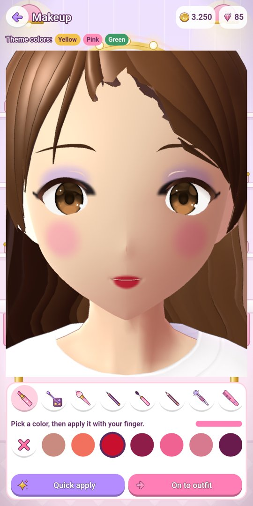
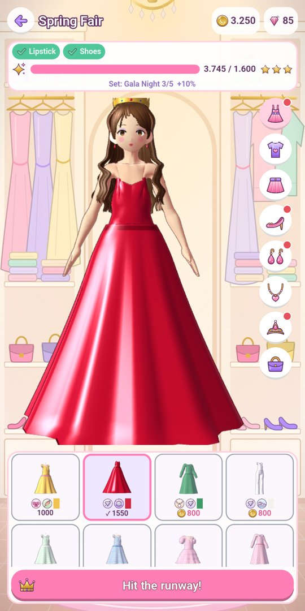
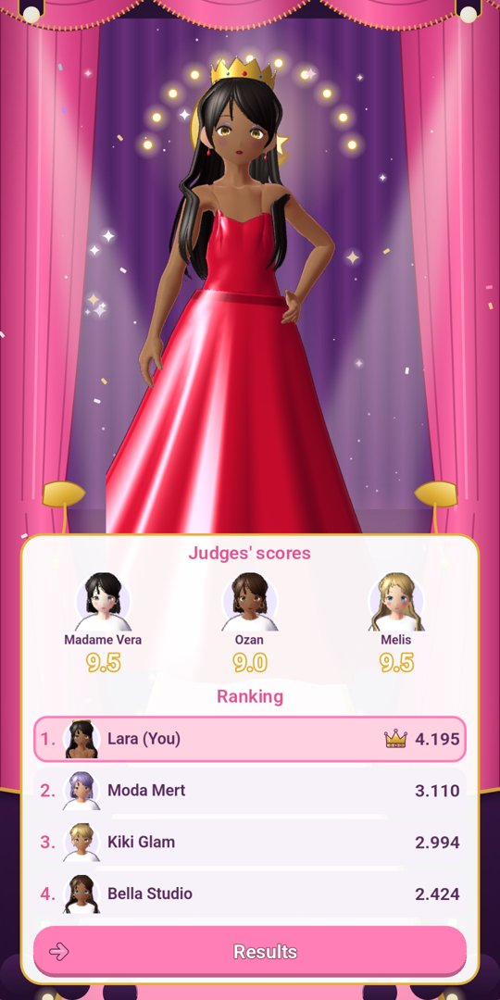
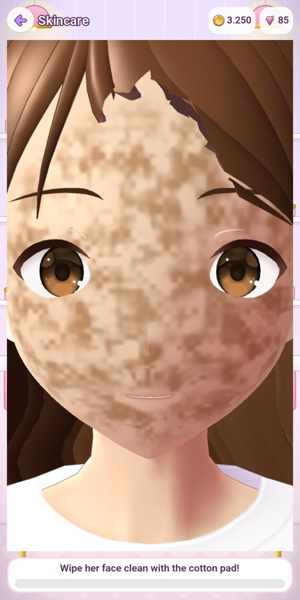
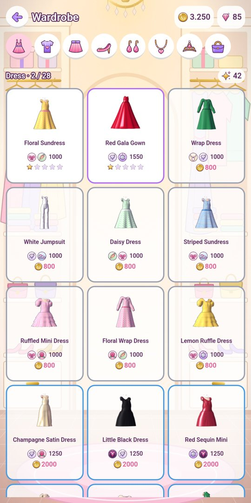

# Glamlune 3D: Makeup & Dress Up

A 3D makeup, dress-up and beauty pageant game for Android. Plays offline.

[Türkçe](#türkçe) · [Privacy policy](privacy.md)

  
  
  
  
  

Makeup · Outfit for the theme · Runway and judges · Skincare · Wardrobe

## Download

- **Android:** coming to Google Play.

## Features

- Get a contestant ready for every pageant: clean her skin, do her makeup with your finger, pick the outfit that best fits the theme and wow the judges on the runway.
- Lipstick, eyeshadow, blush and eyeliner painted on with your finger on her 3D face; lashes and brows to choose from. Every pageant has its own color palette.
- 130 pieces of clothing and accessories in 11 sets. Pieces from the same set earn bonus points, and you can make your favorites shine up to 5 stars.
- 6 tiers and 30 pageants, from the Neighborhood Fair to the Moon Crown, each with its own theme, colors, goals and judges.
- 30 different contestants, a new Theme of the Day every day, and an album where you can save photos of your looks.
- Turn your contestant to see every outfit from all sides. Plays offline and runs smoothly on mid-range phones. English and Turkish.

The game is free and contains ads (strictest child-safe ad settings): a small banner on menu screens and an occasional full-screen ad between pageants. Rewarded ads are optional. Players can remove the banner and full-screen ads with a one-time "Remove Ads" purchase.

## Support

passlune.app@gmail.com

This repository holds the documentation only; the source code is not published here.

---

## Türkçe

3D makyaj, giydirme ve güzellik yarışması oyunu. Android'de internetsiz oynanır.

[Gizlilik politikası](privacy.md#türkçe)

Makyaj · Temaya uygun kıyafet · Podyum ve jüri · Cilt bakımı · Gardırop

### İndir

- **Android:** yakında Google Play'de.

### Özellikler

- Her yarışmada bir yarışmacıyı hazırla: cildini temizle, makyajını parmağınla yap, temaya en uygun kombini seç ve podyumda jüriyi etkile.
- Ruj, far, allık ve eyeliner'ı parmağınla sür; kirpik ve kaş modelini seç. Her yarışmanın kendi renk paleti var.
- 11 sette 130 kıyafet ve aksesuar. Aynı setten parçalar ek puan kazandırır, sevdiğin parçaları 5 yıldıza kadar parlatabilirsin.
- Mahalle Şenliği'nden Ay Tacı'na 6 kademe ve 30 yarışma; her birinin kendi teması, renkleri, şartları ve jürisi var.
- 30 farklı yarışmacı, her gün yeni bir "Günün teması" ve görünümlerinin fotoğrafını kaydedebileceğin bir albüm.
- İnternetsiz oynanır, orta seviye telefonlarda akıcı çalışır. Türkçe ve İngilizce.

Oyun ücretsizdir ve reklam içerir (en sıkı çocuk güvenli reklam ayarlarıyla): menülerde küçük bir alt banner, yarışma aralarında seyrek tam ekran reklam. Ödüllü reklamlar isteğe bağlıdır. Oyuncular tek seferlik "Reklamları kaldır" satın alımıyla banner ve tam ekran reklamları kaldırabilir.

### Destek

passlune.app@gmail.com

Bu depoda yalnızca belgeler bulunur; kaynak kod burada yayımlanmaz.
